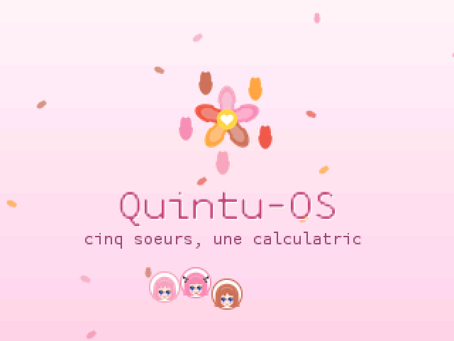
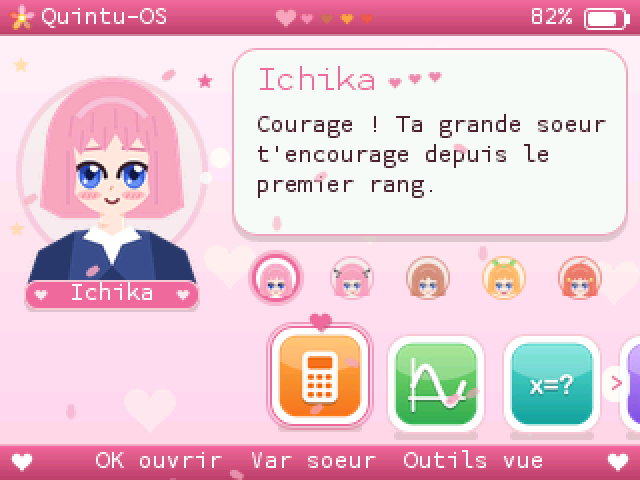
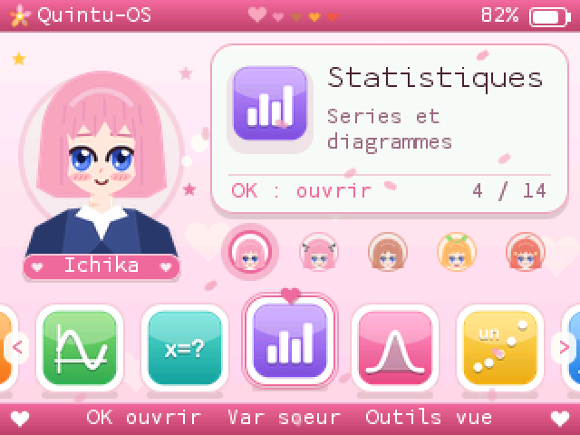
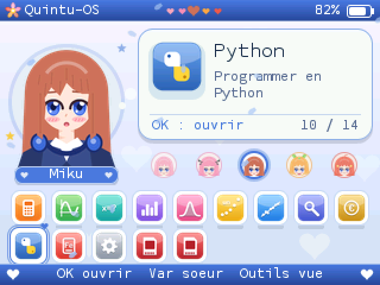
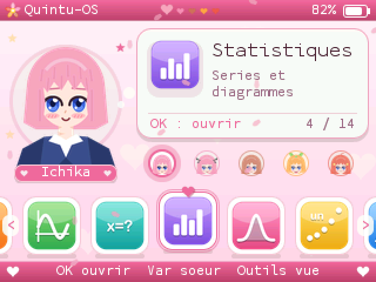
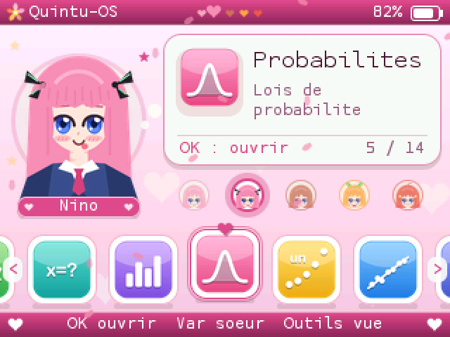
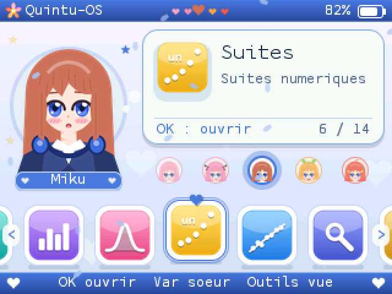
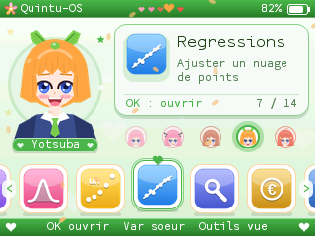
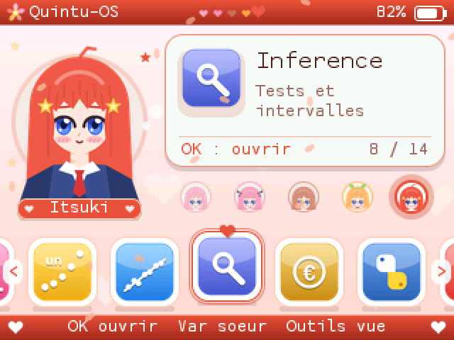
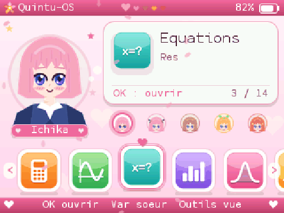

# Quintu-OS : les cinq sœurs sur ta NumWorks

**Quintu-OS transforme l'écran d'accueil de la NumWorks (n0110, n0115 ou
n0120) en thème « The Quintessential Quintuplets »** : Ichika, Nino, Miku,
Yotsuba et Itsuki te présentent tes applis dans une bulle, des pétales de
cerisier tombent sur l'écran, et chaque sœur a ses couleurs. Toute la
calculatrice passe au rose.


<p align="center"></p>

> Captures prises dans le simulateur (batterie affichée à 82 %). Sur la
> calculatrice, tes jeux `.nwa` gardent leur propre icône.

## L'écran d'accueil

- **Démarrage animé** : cinq pétales (un par sœur) tournent et se rejoignent
  en fleur, « Quintu-OS » apparaît en rebondissant, le sous-titre s'écrit
  lettre par lettre et les cinq têtes sautent une par une.
- **La sœur du thème** : son portrait glisse depuis la gauche, respire,
  **cligne des yeux**, **saute** quand tu changes de sœur ou ouvres une appli,
  avec un halo qui pulse et des étoiles qui scintillent autour d'elle.
- **La bulle** : elle s'ouvre en rebondissant et présente l'appli choisie
  (grande icône qui flotte, nom, description tapée lettre par lettre,
  numéro de l'appli). Quand tu changes de sœur, elle te dit d'abord bonjour.
- **Les cinq têtes** : celle de la sœur choisie est entourée et sautille.
- **Carrousel** qui glisse en douceur, tuiles qui tombent en rebondissant,
  cœur qui saute au-dessus de l'appli choisie. **Vue grille** : 18 applis
  par page.
- **Pétales de cerisier** qui tombent en tournoyant, cœurs qui battent dans
  les barres du haut et du bas.
- **Changement de sœur** : une colonne de cœurs balaie l'écran avec les
  nouvelles couleurs.
- **Ouverture d'une appli** : la tuile grandit jusqu'à remplir l'écran, avec
  l'icône, le nom et cinq petits cœurs.

| Démarrage | Bonjour | Accueil | Grille |
| --- | --- | --- | --- |
|  |  |  |  |

| Ichika | Nino | Miku | Yotsuba | Itsuki |
| --- | --- | --- | --- | --- |
|  |  |  |  |  |

<p align="center"></p>

## Commandes

| Touche | Accueil |
| --- | --- |
| Gauche / Droite | appli précédente / suivante |
| Haut / Bas | sœur précédente / suivante (en grille : changer de ligne) |
| OK ou EXE | ouvrir l'appli |
| Var | sœur suivante |
| Outils | carrousel ou grille |
| 1 à 9 | choisir l'appli n (deux fois : l'ouvrir), 0 : Paramètres |
| Retour ou Home | revenir à la première appli |

N'importe quelle touche passe l'animation de démarrage.

## Installation

### 1. Obtenir Quintu-OS

Depuis juillet 2021, le code d'Epsilon (le logiciel de la NumWorks) n'est plus
sous licence libre. Quintu-OS ne publie donc **aucun code ni aucun firmware de
NumWorks** : seulement un **patch** (`patches/quintu-os-epsilon.patch`) et son
propre code. Le firmware se compile à partir des sources officielles de
NumWorks, dans ton compte GitHub ou sur ton Mac.

**Sans rien compiler (Mac ou Windows)**

1. En haut de cette page : **Use this template** > **Create a new
   repository**, coche **Private** (obligatoire : la compilation refuse de
   tourner dans un dépôt public, pour que le firmware ne soit pas
   téléchargeable par tous).
2. Facultatif : ajoute tes jeux `.nwa` dans le dossier `games/` de ta copie
   privée (*Add file* > *Upload files*).
3. Dans ta copie : onglet **Actions** > **Build Quintu-OS** > **Run workflow**.
4. Environ 30 minutes plus tard (un firmware par modèle), en bas de la page
   de la compilation, télécharge **Quintu-OS-Mac** ou **Quintu-OS-Windows**
   et décompresse-le (deux fois pour la version Mac : GitHub met le zip dans
   un zip).

**En compilant sur ton Mac**

```bash
brew install make dfu-util libusb
brew install --cask gcc-arm-embedded
git clone https://github.com/derim00/quintu-os.git && cd quintu-os
./scripts/build-firmware.sh
```

Le script télécharge Epsilon au commit indiqué dans `EPSILON_COMMIT`,
applique le patch, compile, prépare les jeux de `games/` et remplit le
dossier `installer/`.

### 2. Installer sur la calculatrice

**Sur Mac**

1. Une seule fois : `brew install libusb dfu-util` (et
   `brew install --cask gcc-arm-embedded` pour ajouter d'autres jeux).
2. Double-clique sur **`Installer Quintu-OS.command`** (la première fois :
   clic droit > **Ouvrir**). La page de l'installateur s'ouvre
   (http://127.0.0.1:8778).

**Sur Windows** (rien à installer : ni Python, ni pilote)

1. Décompresse **Quintu-OS-Windows** (clic droit > *Extraire tout*).
2. Double-clique sur **`Installer Quintu-OS.exe`** (si SmartScreen
   s'affiche : *Informations complémentaires* > *Exécuter quand même*).
   Laisse la fenêtre noire ouverte, ferme-la à la fin pour quitter.

**Ensuite, sur les deux**

3. Branche la calculatrice en USB et appuie sur **Reset** au dos : elle
   redémarre sur le système officiel.
4. Quand le voyant passe au vert, glisse tes jeux `.nwa` dans la page si tu
   veux, puis clique sur **Installer Quintu-OS**.

Seul le **slot B** est écrit : le système officiel (slot A) n'est jamais
modifié.

## À savoir

- **Calculatrice** : NumWorks **n0110**, **n0115** ou **n0120**, logiciel
  officiel **26.4.0** dans le slot A. L'installateur choisit tout seul le
  firmware du modèle branché.
- **Un seul système dans le slot B** : Quintu-OS remplace 3DS-OS, Mimi-OS,
  iOS-OS, Wii U-OS, Windows-OS, Switch-OS, PSP-OS… (et inversement). Les
  installateurs peuvent tourner en même temps (Quintu-OS utilise le port
  8778).
- **Après un Reset**, la calculatrice revient sur le système officiel : il
  suffit de relancer l'installation.
- **Sœur et affichage** : ils restent choisis tant que la calculatrice ne
  redémarre pas (après un Reset, on revient à Ichika et au carrousel).
- **Accents** : la police de la NumWorks n'a pas de lettres accentuées ; les
  textes s'affichent sans accents.
- **Home et On/Off** : le correctif du plantage Home / On-Off de Windows-OS
  est repris. Home ramène toujours à l'écran d'accueil.
- **Jeux** : seulement des applis `.nwa` dont tu as le droit de te servir, et
  uniquement dans ta copie privée : jamais dans un dépôt public.

## Comment c'est fait

| Fichier (dans le patch) | Rôle |
| --- | --- |
| `apps/home/quint/shell.cpp` | écran d'accueil : portrait, bulle, têtes, carrousel et grille, sœurs (thèmes) et toutes les animations |
| `apps/home/quint/gfx.cpp` | rendu par bandes en RAM (repris de 3DS-OS), images avec transparence, texte, formes arrondies, traits antialiasés |
| `apps/home/quint/gen_icons.py` | dessine les cinq portraits, les têtes, les icônes, la fleur, les pétales et les cœurs dans `quint_icons.h` |
| `apps/home/controller.cpp` | relie l'accueil à Escher et dessine les animations directement à l'écran |
| `escher/include/escher/palette.h`, `theme/light_theme.h` | le thème rose de toute la calculatrice |
| `escher/src/run_loop.cpp` | animations : l'appli d'accueil peut demander une image toutes les 40 ms |
| `scripts/photos.py` | transforme la séance photo du simulateur (`DS_SHOTS=dossier`) en PNG et GIF |

## Licence

Le code de Quintu-OS est sous licence **CC BY-NC-SA 4.0** (voir `LICENSE`).
Epsilon reste la propriété de NumWorks et n'est pas inclus dans ce dépôt.
Les cinq sœurs sont des **portraits de fan dessinés avec des formes simples**
(`gen_icons.py`) : aucune image du manga ou de l'anime n'est utilisée.
Quintu-OS est un projet de fan, sans lien avec NumWorks ni avec les auteurs
ou éditeurs de *The Quintessential Quintuplets* (*Go-Tôbun no Hanayome*).
